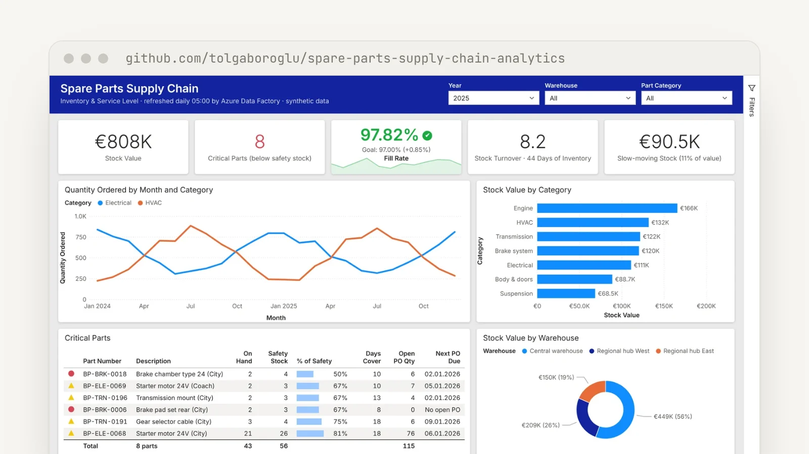
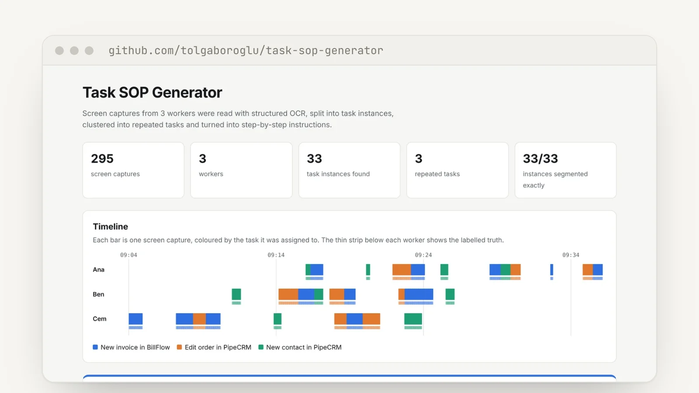
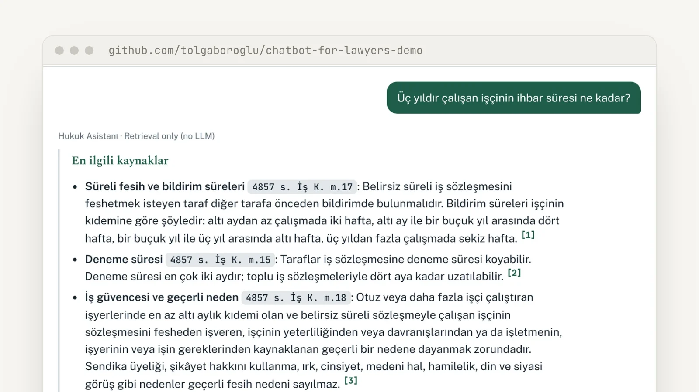
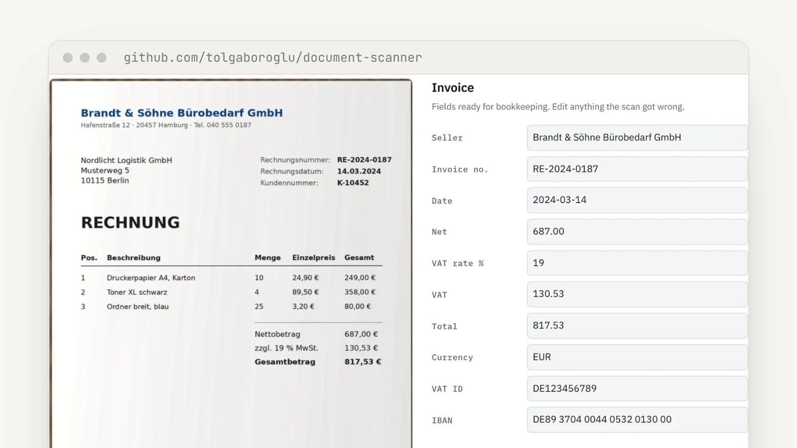

<h1 align="center">Hi, I'm Tolga 👋</h1>
<h3 align="center">Analytics Engineer &amp; Data Analyst</h3>

I turn raw business data into clean models, reliable dashboards and automated workflows, 
and build AI tools when a problem needs more than a report.

  
  

---

### What I do

- **Data modelling & ETL:** design SQL models and Azure Data Factory pipelines that turn messy source data into analysis-ready tables.
- **Dashboards & reporting:** Power BI, Tableau and Metabase reports that answer real business questions, built on solid data models.
- **Automation:** Python and Power Query pipelines that replace manual Excel work.
- **Applied AI:** machine learning, NLP and document AI when the data allows it.

### Tech stack

**Analytics:**

**Engineering & AI:**

### Featured projects

<table>
<tr>
<td width="50%" valign="top">

 <code>INDUSTRY PROJECT · AUTOMOTIVE</code>
<h3><a href="https://github.com/tolgaboroglu/spare-parts-supply-chain-analytics">Spare Parts Supply Chain Analytics</a></h3>
Data pipeline and Power BI dashboard for a bus manufacturer's spare-parts business. Six feeds from SAP ERP and SQL Server loaded nightly into an Azure SQL star schema.
  <b>Azure Data Factory · Azure SQL · Power BI · DAX</b>
</td>
<td width="50%" valign="top">

 <code>CLIENT PROJECT · UPWORK · MVP</code>
<h3><a href="https://github.com/tolgaboroglu/task-sop-generator">Task SOP Generator</a></h3>
Finds repeated tasks in workers' screen captures, even when they switch between tasks, and writes step-by-step SOPs with inputs, outputs and rules.
  <b>Python · OCR · OpenCV · scikit-learn · LLMs</b>
</td>
</tr>
<tr>
<td width="50%" valign="top">

 <code>CLIENT PROJECT · UPWORK · TURKEY</code>
<h3><a href="https://github.com/tolgaboroglu/chatbot-for-lawyers-demo">Chatbot for Lawyers</a></h3>
AI legal assistant for a law firm in Turkey. Answers questions on legislation and case law and cites the exact sources.
  <b>Python · RAG · LLMs · BERTurk · Flask</b>
</td>
<td width="50%" valign="top">

 <code>CLIENT PROJECT · UPWORK · GERMANY</code>
<h3><a href="https://github.com/tolgaboroglu/document-scanner">DocScan</a></h3>
Reads supplier invoices into bookkeeping fields with automatic checks, turns old paper records into searchable PDFs and scans business cards into contacts.
  <b>Python · OpenCV · Tesseract · spaCy · Flask</b>
</td>
</tr>
</table>
